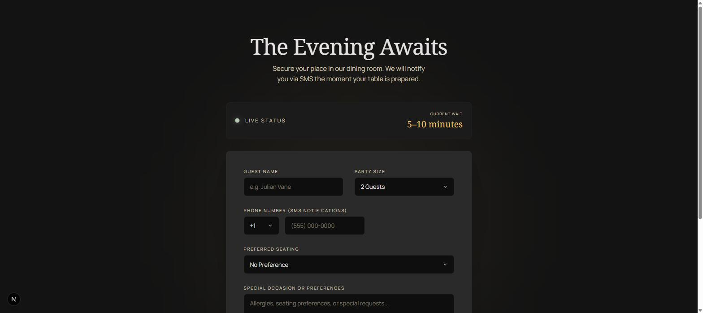
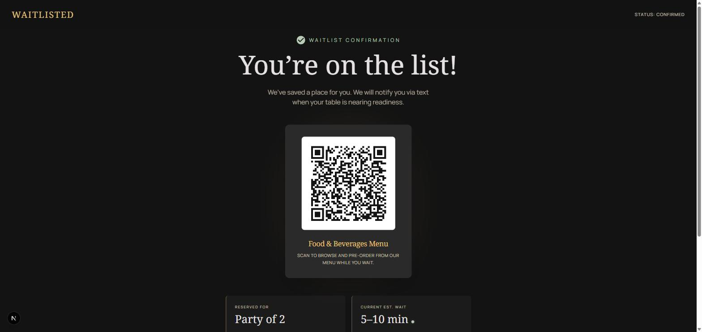
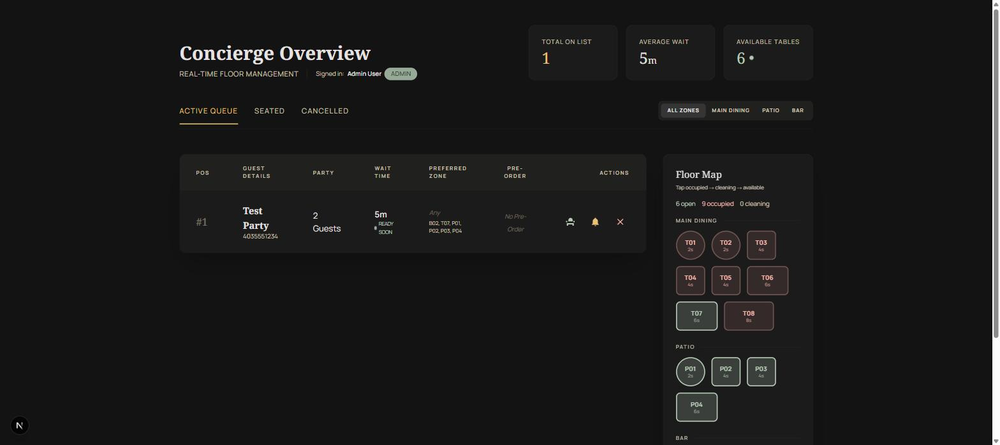
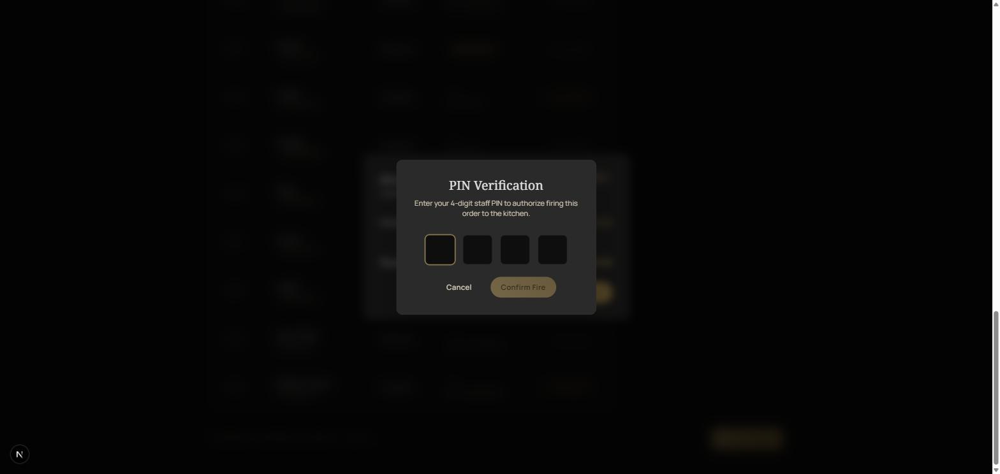
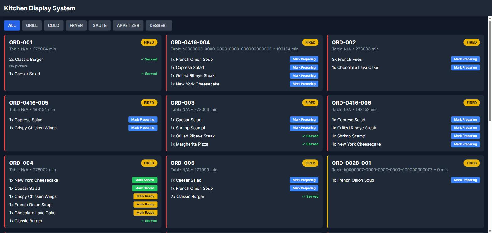

# Waitlisted

A waitlist and pre-order kiosk for a fine-dining restaurant. Submitted as
the final project for CPRG 306D.

Waitlisted runs on a touch-only tablet at the host stand. Guests add
themselves to the waitlist, get a trackable status link, and can browse
the menu and build a pre-order while they wait. Staff use a PIN-authenticated
dashboard to seat guests, manage tables, and fire confirmed pre-orders to
the kitchen.

This app is the **guest-facing half** of a two-app system. The other half
is [`restaurant-pos`](https://github.com/Stephen-C-Noh/restaurant-pos) - a
Spring Boot POS that owns the shared Postgres database's state machine,
Kafka events, and WebSocket broadcasts to the Kitchen Display.

---

## Screenshots

| | |
| --- | --- |
|  |  |
| Idle kiosk slideshow; any tap starts the waitlist flow | Guest waitlist entry form with a live wait-time estimate |
|  |  |
| Confirmation screen with a QR code guests scan to browse the menu and pre-order | Concierge Overview: the live waitlist queue alongside the floor map |
|  |  |
| Second-PIN confirmation gate required before a pre-order reaches the kitchen | The fired order on the `restaurant-pos` Kitchen Display, delivered through the POS outbox, Kafka and WebSocket |

---

## Running the demo

You will need both repos cloned, Docker Desktop running, and Node.js 22
(see `.nvmrc`) installed. The backend stack is containerized; this Next.js app runs via
`npm`.

### 1. Clone both repos side by side

```bash
git clone https://github.com/Stephen-C-Noh/restaurant-pos.git
git clone https://github.com/Stephen-C-Noh/waitlisted.git
```

### 2. Start the backend stack

From the `restaurant-pos` repo, bring up Postgres, Kafka, Zookeeper, the
Spring Boot API, and the POS frontend (which includes the Kitchen Display):

```bash
cd restaurant-pos/docker
docker compose up -d
```

First run builds two images (~5 min on a warm cache). Verify the backend
is healthy before continuing:

```bash
curl http://localhost:8090/actuator/health
# {"status":"UP", ... }
```

If the command returns `Connection refused`, wait another 30 seconds -
Spring Boot takes a moment after Postgres and Kafka pass their healthchecks.

### 3. Start the waitlist app

From this repo:

```bash
cp .env.example .env.local
```

Open `.env.local` and set `JWT_SECRET` to any long random string (e.g.
`openssl rand -base64 32`). All other defaults target the dockerized stack
and work as-is.

Then:

```bash
npm install
npm run db:setup   # first time only: creates the three waitlist tables (POS stack must be up)
npm run dev
```

The kiosk is now at **http://localhost:3000**.

Why not just `prisma migrate deploy`: the database already holds the POS
tables, so Prisma refuses to migrate a non-empty schema without history
(P3005). `db:setup` runs the baseline SQL, marks it applied, then deploys
anything newer. After that, new migrations need only `npx prisma migrate deploy`.
Already have the three tables from an earlier manual setup? Mark the
baseline as applied instead: `npx prisma migrate resolve --applied 0001_waitlist_tables`.

**Never run `prisma migrate dev` in this repo.** `schema.prisma` also holds
the introspected POS tables, which Flyway owns and which are not in the
Prisma migration history, so `dev` would try to create or reset them. Write
new migrations by hand or with `npx prisma migrate diff`.

### 4. What to open

| URL                                   | What it is                                      |
| ------------------------------------- | ----------------------------------------------- |
| http://localhost:3000                 | Slideshow / kiosk home - tap anywhere           |
| http://localhost:3000/waitlist        | Guest entry form                                |
| http://localhost:3000/admin/login     | Staff dashboard (requires PIN)                  |
| http://localhost:5173/kds             | **Kitchen Display** (POS frontend, kitchen PIN) |
| http://localhost:5050                 | pgAdmin (DB GUI, optional)                      |
| http://localhost:8080                 | Kafka UI (event stream, optional)               |

### 5. Demo PINs

| PIN  | User     | Role    |
| ---- | -------- | ------- |
| 1234 | admin    | ADMIN   |
| 5678 | manager1 | MANAGER |
| 9012 | server1  | SERVER  |
| 3456 | server2  | SERVER  |

The KITCHEN role cannot log in to Waitlisted (front-of-house only). The
Kitchen Display in the POS frontend logs in as `kitchen1` with PIN `7890`.

### 6. End-to-end walkthrough

A short scripted flow that exercises every piece of the system:

1. **Guest** opens http://localhost:3000, taps the slideshow. Fills out
   the waitlist form with any name, party size, and phone number.
2. **Guest** lands on the confirmation page, then navigates to the
   status link. The wait-time estimate recalculates every 10 seconds.
3. **Guest** taps "Browse Menu" and adds a few items to a pre-order.
4. **Staff** opens http://localhost:3000/admin/login in a second browser
   window. PIN `1234`. The dashboard shows the new waitlist entry.
5. **Staff** uses the seat action on the entry and picks an available
   table. The table turns OCCUPIED; within about 20 seconds (10 s poll,
   then the query's retries) the guest's status page switches to "Entry
   Unavailable: This entry has been seated"; remaining guests' wait
   estimates are recalculated on their next poll.
6. **Staff** opens the seated guest's pre-order, taps **Fire to Kitchen**,
   and re-enters their PIN (the second-PIN gate prevents accidental fires).
7. **Kitchen Display** at http://localhost:5173/kds (log in with PIN
   `7890`) shows the new ticket.

Step 7 is the architectural payoff: the fire request goes through the
Spring Boot state machine, which writes an `OrderFired` event to its outbox
in the same transaction. A relay publishes the event to Kafka, and the
POS's Kafka consumer pushes the order over WebSocket (`/topic/orders`) to
the Kitchen Display, a separate React frontend. Measured on the local
stack from the POS fire commit to the card on screen: 22.5 ms median,
35 ms worst (`restaurant-pos/docs/perf/kds-latency.md`). That excludes the
Waitlisted side (the Next.js route, the PIN check and the POS create and
fire calls). If Kafka is down, the fire
still succeeds and the ticket appears once Kafka is back.

---

## Architecture

- **Reads** (menu, tables, waitlist) go directly through Prisma for speed.
- **Writes with business logic** (table status, create + fire order) go
  through the Spring Boot POS so its state machine, Kafka outbox, and
  WebSocket broadcasts fire correctly. If the POS is down these routes
  return an error (503 when unreachable) and change nothing; there is no
  Prisma fallback. With `POS_INTEGRATION_ENABLED=false` (cloud deploy, no
  POS) the dashboard disables Seat, Fire and table-status actions.
- Prisma owns three new tables (`waitlist_entries`, `pre_orders`,
  `pre_order_items`) and introspects the rest of the schema from the POS.
- Login sets the Next.js staff token (signed with `jose`) and, when Spring
  Boot is reachable, a separate token for the Spring Boot API; without it,
  seat, table status and fire fail (see Troubleshooting). Both cookies are
  `HttpOnly; SameSite=Strict`.

Full design docs live under `Plans/`. The authoritative design system
(tokens, rules, mockups) is in `Guide/Design/`.

## Load-bearing UX rules

1. **Seat and fire are separate actions.** Seating a guest updates the
   table and marks the waitlist entry `SEATED` but does **not** fire the
   pre-order. That's a distinct dashboard action.
2. **Firing requires a second PIN.** Before the fire request is sent to
   Spring Boot, the staff member re-enters their 4-digit PIN. The PIN is
   re-verified server-side against the logged-in user's own PIN (another
   staff member's PIN is rejected). The user who creates the POS order is
   recorded in `pre_orders.fired_by_user_id`, matching the order's server.

These exist so a kitchen ticket can't be created without a human
confirming at that exact moment.

## Stack

- **Next.js 16** (App Router) + **React 19** + **TypeScript 5**
- **Tailwind v4** (CSS-first via `@theme` in `globals.css`)
- **Prisma 7** with `@prisma/adapter-pg` → PostgreSQL 16
- **TanStack Query v5**, **Zustand v5**, **Framer Motion v12**
- **jose** (JWT), **bcryptjs** (PIN hashing), **Zod** (validation)

Middleware lives in `src/proxy.ts` (Next.js 16 naming), not `middleware.ts`.

## Route map

### Public (`src/app/(public)`)
- `/` and `/slideshow` - idle menu slideshow; any touch navigates to `/waitlist`
- `/waitlist` - guest entry form
- `/waitlist/[token]/confirmation` - confirmation with queue position
- `/waitlist/[token]/status` - live-polling status page (10 s)
- `/menu/[token]` - pre-order menu and cart

### Staff (`src/app/(staff)`)
- `/admin/login` - 4-digit PIN login
- `/admin/dashboard` - waitlist, floor map, pre-orders

`proxy.ts` guards `/admin/*` by verifying the staff JWT cookie.

## Project layout

```
src/
  app/
    (public)/       Guest-facing routes
    (staff)/        PIN-gated admin routes
    api/            Route handlers
  components/       UI components
  hooks/            useIdleDetection
  lib/
    auth.ts                 PIN verification + JWT signing
    prisma.ts               Prisma client singleton
    wait-time.ts            Wait-time estimator
    spring-boot-client.ts   HTTP client for the POS
    validations.ts          Zod schemas for all route bodies
  stores/           Zustand stores
  proxy.ts          Staff auth middleware
prisma/
  schema.prisma     Introspected POS tables + the three waitlist tables
  migrations/       Waitlist tables only (never `prisma migrate dev`)
Plans/              Design docs (source of truth)
Guide/
  Database/V1–V6    Old reference copy of the POS Flyway migrations (the POS
                    is ahead; its own repo is the source of truth)
  Design/           Design system + HTML mockups
```

## Scripts

| Command         | What it does             |
| --------------- | ------------------------ |
| `npm run dev`   | Start dev server         |
| `npm run build` | Production build         |
| `npm run start` | Run the production build |
| `npm run lint` | ESLint                   |
| `npm test`     | Vitest                   |
| `npm run db:setup` | First-time database setup (waitlist tables) |

## Metrics

`GET /api/metrics` serves Prometheus metrics: request duration by route
template and status for the waitlist create/list/status, seat, table status,
fire and login routes, plus Node defaults. Set `METRICS_TOKEN` to require
`Authorization: Bearer <token>` (401 otherwise). With no token it is open
outside production and returns 404 in production, which includes the Docker
image (`NODE_ENV=production`), so any containerized deploy needs the token.
Prometheus sends the token with `authorization: { credentials: <token> }` in
the scrape config.

## Design system

Non-negotiable rules from `Guide/Design/DESIGN.md`:

- No 1px dividers - use tonal background shifts
- No pure white - use `on_surface #e5e2e1`
- Gold `#e9c176` is reserved for "moment of truth" CTAs
- Tonal layering instead of shadow elevation levels

The authoritative Tailwind token map is in the inline `<script>` at the
top of each `Guide/Design/*/code.html` mockup.

## Troubleshooting

**`docker compose up` hangs on "waiting for healthy kafka"**
Kafka sometimes takes 30–60 s to pass its broker-api-versions check on
the first cold boot. Give it a minute. If it doesn't recover, `docker
compose down && docker compose up -d` usually fixes it.

**Spring Boot container restarts in a loop**
Most often because Postgres wasn't ready in time on an old-cache start.
`docker compose logs backend` will show `UnknownHostException` or
`Connection refused` - restart with `docker compose restart backend`.

**Seating or firing fails with "POS unavailable" or "POS session expired"**
Login works while the Spring Boot backend is down (Postgres must be up):
the Next.js login route also asks Spring Boot for a POS token, and if the
backend is unreachable it signs you in without one.
Seating, table status and firing then fail (503 "POS unavailable" while the
backend is unreachable, 502 "POS session expired - sign out and back in"
when the POS token is missing or expired). Start the backend, wait for
`/actuator/health` to report `UP`, then log out and back in.
